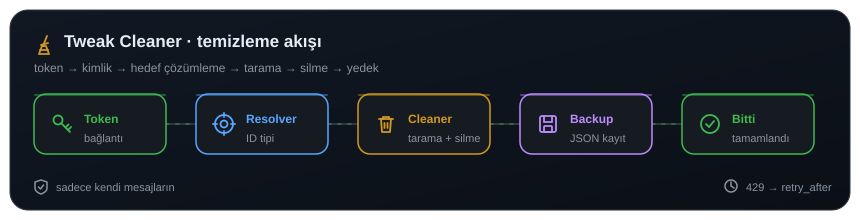

<div align="center">

# 🧹 Tweak Cleaner

### ✨ Kendi hesabının mesajlarını hedef ID'ye göre tarar, siler ve istersen yedekler.



### 🎯 `Token` · `ID` · `Backup` — üç ayar, tek komut.

| 🧩 Özellik | ⚡ Durum |
|---|:---:|
| 🔐 Kendi hesabınla bağlantı | ✅ |
| 🎯 DM / Sunucu / Ses / Metin kanalı | ✅ |
| 🛡️ Sadece kendi mesajların | ✅ |
| ⏳ Rate limit otomatik bekleme | ✅ |
| 💾 JSON yedek (UTC+3) | ✅ |

</div>

---

## 🇹🇷 Türkçe

### 🚀 Ne yapar?

`start.bat` açılır, token'ı sorar, hedef ID'yi sorar, yedek isteyip istemediğini sorar. Sonra aracı başlatır. Senin hesabınla bağlanır, hedefin türünü kendisi çözer ve **sadece senin attığın mesajları** siler.

### 🎯 Hedef rehberi

| Girdiğin ID | Ne temizlenir | Örnek |
|---|---|---|
| 💬 DM ID'si | O DM'deki senin mesajların | `1074...` |
| 🏰 Sunucu ID'si | Sunucudaki tüm metin ve ses kanallarındaki mesajların | `9182...` |
| 🔊 Ses kanalı ID'si | O kanalın yazı sohbetindeki mesajların | `5521...` |
| 📺 Normal kanal ID'si | O kanaldaki mesajların | `8830...` |

### 🧠 Akış nasıl işler?

1. 🔑 `Token` ile hesaba bağlanır, kimlik doğrulanır.
2. 🧭 `Resolver` verilen ID'nin türünü çözer.
3. 🔎 `Cleaner` mesajları sayfa sayfa tarar.
4. 🗑️ Yazarı sen olan mesajları siler.
5. 💾 `Backup` açıksa her mesajı JSON'a yazar.
6. ⏳ 429 gelirse `retry_after` kadar bekleyip devam eder.

### 💾 Yedek dosyası

`Backup` açık ise her silinen mesaj şuraya yazılır:

```text
Backup/<hedef-id>/<kanal-id>.json
```

Tarih 🕒 `Europe/Istanbul` (UTC+3) saat diliminde, `tr-TR` biçimindedir. Kapalı ise hiçbir yere yazılmaz, `Backup/` klasörü bile açılmaz.

Örnek kayıt:

```json
[
  {
    "channelId": "883012345678901234",
    "messageId": "991123456789012345",
    "content": "merhaba",
    "timestamp": "14.11.2026 18:42:07"
  }
]
```

### 📁 Dosya yapısı

```text
Tweak Cleaner/
├─ 🎨 assets/
│  └─ demo.svg          → Bu dosya yukarıdaki hareketli akış çizimini çizer
├─ 💾 Backup/
│  └─ <hedef-id>/       → Bu klasör yedeklenen mesaj JSON'larını tutar (çalışınca oluşur)
├─ ⚙️ Settings/
│  ├─ Settings.ts       → Bu dosya TOKEN / ID / BACKUP ortam değişkenlerini okur
│  └─ README.md         → Bu dosya kısa kurulum ve ayar notları
├─ 🧠 System/
│  ├─ index.ts          → Bu dosya akışı başlatır, token'ı doğrular, sonucu raporlar
│  ├─ Client.ts         → Bu dosya API isteklerini, rate limit beklemesini ve log'u yapar
│  ├─ Resolver.ts       → Bu dosya ID'nin dm / sunucu / ses / metin olduğunu çözer
│  └─ Cleaner.ts        → Bu dosya mesajları tarar, siler ve yedek JSON'u yazar
├─ ▶️ start.bat         → Bu dosya token/ID/backup sorar, modülleri kurar ve başlatır
├─ 📦 package.json      → Bu dosya bağımlılıkları ve npm komutlarını tanımlar
├─ 🔧 tsconfig.json     → Bu dosya TypeScript derleme ayarlarını tutar
├─ 🛡️ .gitignore        → Bu dosya node_modules, dist, Backup ve gizli dosyaları repodan hariç tutar
└─ 📄 README.md         → Bu dosya bu dokümandır
```

### ▶️ Çalıştırma

Windows PowerShell'de `npm` script'i execution policy yüzünden engellenebilir. Bu yüzden `.cmd` kullanılır:

```powershell
.\start.bat
```

İstenenler:

```text
🔑 Token:  hesabının token'ı
🆔 ID:     DM / sunucu / kanal ID'si
💾 Backup: true veya false (varsayılan true)
```

El ile çalıştırmak istersen:

```powershell
$env:TOKEN = "token"
$env:ID = "hedef-id"
$env:BACKUP = "true"
npm.cmd install
npm.cmd start
```

---

## 🇬🇧 English

### 🚀 What it does

Run `start.bat`: it asks for your token, target ID and backup preference, then starts the tool. It connects with your own account, resolves the target type automatically and deletes **only your own messages**.

### 🎯 Target guide

| ID you enter | What gets cleaned | Example |
|---|---|---|
| 💬 DM ID | Your messages in that DM | `1074...` |
| 🏰 Server ID | Your messages in every text and voice channel of the server | `9182...` |
| 🔊 Voice channel ID | Your messages in that channel's text chat | `5521...` |
| 📺 Text channel ID | Your messages in that channel | `8830...` |

### 🧠 How the flow works

1. 🔑 Connect with `Token`, verify identity.
2. 🧭 `Resolver` detects the ID type.
3. 🔎 `Cleaner` scans messages page by page.
4. 🗑️ Delete the ones authored by you.
5. 💾 `Backup` on → write each message to JSON.
6. ⏳ 429 → wait for `retry_after` and resume.

### 💾 Backup file

When `Backup` is on, every deleted message is written to:

```text
Backup/<target-id>/<channel-id>.json
```

Timestamps use 🕒 `Europe/Istanbul` (UTC+3) in `tr-TR` format. When off, nothing is written — not even the `Backup/` folder.

### 📁 File structure

```text
Tweak Cleaner/
├─ 🎨 assets/
│  └─ demo.svg          → draws the animated flow diagram above
├─ 💾 Backup/
│  └─ <target-id>/      → holds backed-up message JSON files (created at runtime)
├─ ⚙️ Settings/
│  ├─ Settings.ts       → reads TOKEN / ID / BACKUP environment variables
│  └─ README.md         → short setup and settings notes
├─ 🧠 System/
│  ├─ index.ts          → entry point: validates token, runs the flow, reports results
│  ├─ Client.ts         → API requests, rate-limit waiting and console logging
│  ├─ Resolver.ts       → resolves the ID as dm / server / voice / text
│  └─ Cleaner.ts        → scans messages, deletes them and writes backup JSON
├─ ▶️ start.bat         → asks for token/ID/backup, installs modules and starts the tool
├─ 📦 package.json      → defines dependencies and npm scripts
├─ 🔧 tsconfig.json     → TypeScript compiler settings
├─ 🛡️ .gitignore        → keeps node_modules, dist, Backup and secrets out of the repo
└─ 📄 README.md         → this document
```

### ▶️ Run

On Windows PowerShell, `npm` may be blocked by execution policy, so the `.cmd` shim is used:

```powershell
.\start.bat
```

It asks for:

```text
🔑 Token:  your account token
🆔 ID:     DM / server / channel ID
💾 Backup: true or false (default true)
```

Manual run:

```powershell
$env:TOKEN = "token"
$env:ID = "target-id"
$env:BACKUP = "true"
npm.cmd install
npm.cmd start
```

---

⚠️ Bu proje yalnızca test amaçlıdır. Kullanımından doğabilecek her türlü riskden sorumluluk kabul edilmez.

⚠️ This project is for testing purposes only. The author is not responsible for any risks arising from its use.
